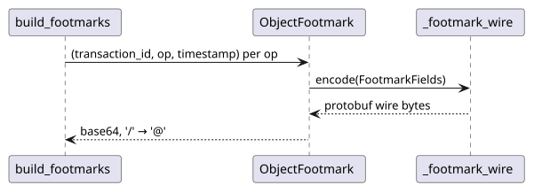

# Footmarks and timestamps

How a footmark token is built and parsed, how a footmark path parks a change beside its original,
why the wire codec and the timestamp text form are frozen, and how their compatibility is tested.
Rules are owned by [STORAGE.md](../../STORAGE.md#footmarks) and
[STORAGE.md](../../STORAGE.md#timestamps); the user view is
[transactions.md](../guides/transactions.md).

## Code map

| Concern | Module | Notes |
| -- | -- | -- |
| Tokens | `txstore/footmark.py` | `ObjectFootmark.serialize` / `from_token`, `build_footmarks`, `parse_footmark_token` |
| Paths | `txstore/footmark.py` | `footmark_path`, `split_footmark_path` → `FootmarkPath(original, token)`; shared by `_categorize` and `_reclaim` |
| Wire codec | `txstore/_footmark_wire.py` | `encode`, `decode`, `FootmarkFields` |
| Timestamp | `txstore/_timestamp.py` | `Timestamp`, `to_json`, `from_json` |
| Schema | [footmark.proto](../reference/footmark.proto) | The message the codec implements |

## Token path

### Details that matter

- Tokens are not stored. The history keeps `{id, timestamp}` and revert rebuilds the tokens, so the
  bytes for a given `(id, timestamp, op)` must never change: a different encoding would make every
  existing footmark unreachable.
- The timestamp text is part of that input. `Timestamp.to_json` and `from_json` reproduce the
  protobuf `Timestamp` JSON mapping, including its quirks (a trailing `.` without digits parses,
  `±HH:MM` offsets are accepted, output always ends in `Z`).
- The decoder follows proto3 so that tokens written by any protobuf implementation parse; it is
  stricter only where protobuf would accept groups, which no footmark contains.
- `parse_footmark_token` decides what the orphan sweep deletes, so every ambiguity rejects: bad
  base64, an undecodable message, a foreign header, a non-positive id, an unknown operation, an
  out-of-range timestamp, or a segment that is not byte-for-byte what `serialize` writes for the
  decoded fields (stray characters, non-canonical padding, unknown or repeated wire fields).
- `footmark_path` builds `<dir>/.<file>.<token>` and `split_footmark_path` is its one inverse,
  shared by `_categorize` and `_reclaim`, so commit, revert, and the orphan sweep agree on which
  names are footmarks of which original. Whether the trailing segment is a token is left to
  `parse_footmark_token` → [STORAGE.md](../../STORAGE.md#footmarks).

## Testing notes

`tests/test_footmark.py` covers token round trips, every `parse_footmark_token` rejection, and the
`footmark_path` / `split_footmark_path` round trip. `tests/test_footmark_wire.py` and
`tests/test_timestamp.py` hold golden vectors captured once from a protobuf runtime; they need no
protobuf to run. Before changing either module, re-run a differential fuzz against a protobuf
runtime outside the test suite.

## Related contracts

- [STORAGE.md](../../STORAGE.md#footmarks) owns the token and wire rules;
  [STORAGE.md](../../STORAGE.md#record) owns the history record.
- [TESTING.md](../../TESTING.md#required-coverage) owns the golden-vector requirement.
- Sibling pages: [architecture.md](architecture.md), [class.md](class.md),
  [transactions.md](transactions.md), [s3.md](s3.md).
