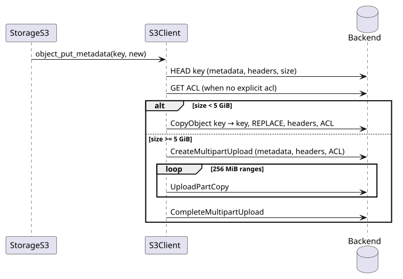
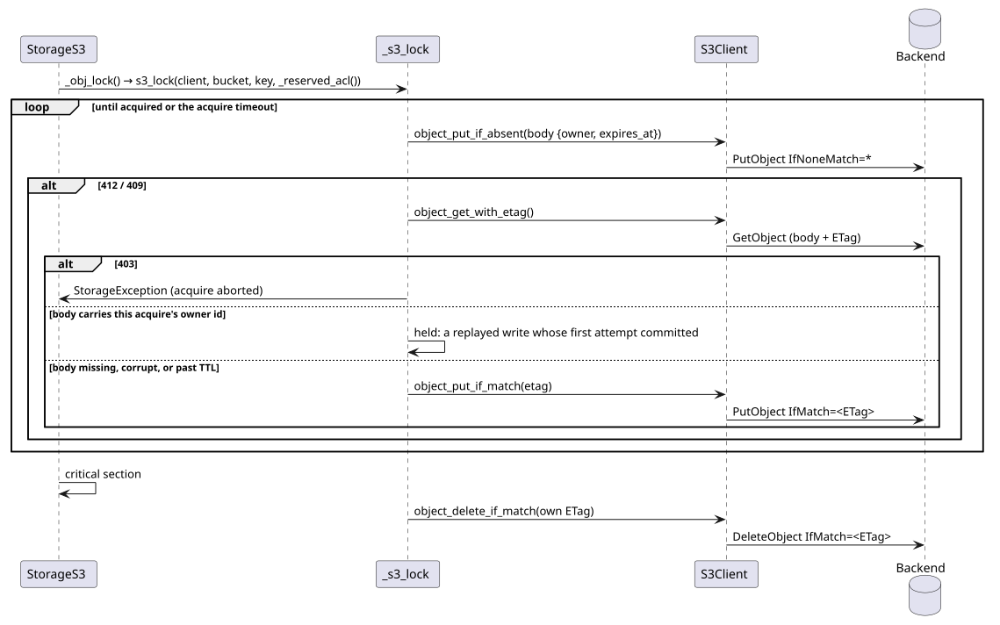

# S3 backend internals

How `StorageS3` talks to S3: the boto3 wrapper, ACL preservation, metadata rewrites, error
classification, and the conditional-write lock. Rules are owned by
[STORAGE.md](../../STORAGE.md#s3-acl-rules), [STORAGE.md](../../STORAGE.md#s3-metadata-rewrites),
and [STORAGE.md](../../STORAGE.md#locking); the user view is [backends.md](../guides/backends.md).

## Code map

| Concern | Module | Notes |
| -- | -- | -- |
| Client | `txstore/_s3_client.py` | `S3Client` on a boto3 resource; canned-ACL literals; metadata rewrites |
| Backend | `txstore/storage_s3.py` | Maps keys and prefixes, wraps errors as `StorageException` |
| ACL sidecar | `txstore/storage_s3.py` | `_acls` remembers the ACL written to each key in the active transaction |
| Public probe | `txstore/_s3_acl.py` | `is_public` reads the live grants, retried with back-off |
| Error classes | `txstore/_s3_errors.py` | Not-found, precondition-failed, conditional-conflict tests; `s3_errors` wrapping |
| Lock | `txstore/_s3_lock.py` | `IfNoneMatch` / `IfMatch` conditional writes through `S3Client` |

## Metadata rewrite

### Details that matter

- `REPLACE` resets everything not passed again, so the five system headers and the group canned ACL
  are read first and re-sent.
- A failed part aborts the multipart upload before re-raising, so no partial upload lingers.
- Only group grants map to canned ACLs (`public-read`, `public-read-write`, `authenticated-read`);
  per-user grants are not carried by a copy, which is why `_obj_copy` passes the ACL the sidecar
  recorded for the source in the transaction to `object_copy`.
- `bucket_head` and `object_head` classify nothing: every failure, a missing key included, raises as
  boto3 raised it. `StorageS3` reads "absent" from `is_s3_not_found` (keys) and
  `is_s3_bucket_not_found` (the bucket), so a 403 or 5xx never reads as "absent".

## Writer lock

### Details that matter

- Breaking an expired lock and acquiring it are one `IfMatch` write, so a peer that acquires first
  keeps its lock → [STORAGE.md](../../STORAGE.md#locking).
- Each acquire writes a fresh owner id, and a live body carrying it is adopted, not waited on:
  botocore's retry of a write whose first attempt committed answers 412.
- A transient read failure never makes a lock breakable; only a successful read of a missing,
  corrupt, or expired body does.
- A write whose response carries no ETag deletes the body before raising, so peers are not blocked
  for the whole TTL.
- Release leaves a changed or absent object alone and retries a failing delete.
- Every lock write carries the reserved ACL → [STORAGE.md](../../STORAGE.md#s3-acl-rules).
- A refused lock read (403) aborts the acquire with `StorageException`, as a refused write does; any
  other failing read logs one warning per acquire, then debug lines, while it keeps waiting →
  [STORAGE.md](../../STORAGE.md#locking).

## Error classification

- `s3_errors(message, on_error=..., not_found=...)` in `_s3_errors.py` turns `ClientError`,
  `BotoCoreError`, and `OSError` into a chained `StorageException`; with `not_found` set, a
  not-found error becomes `StorageNotFoundException` → [EXCEPTIONS.md](../../EXCEPTIONS.md#rules).
- `_s3_errors.py` is the only not-found classifier. `is_s3_not_found` never reads a 404 carrying
  `NoSuchBucket` as a missing key; `is_s3_bucket_not_found` is its bucket counterpart.
- The lock classifies refused conditional writes (412, 409) as "retry" and is deliberately looser
  than the not-found test.

## Testing notes

`tests/test_s3_client.py` exercises every client method against moto, including the multipart
rewrite (threshold patched low) and its abort; `tests/test_s3_acl.py` covers the probe with a stub
client; `tests/test_storage_s3.py` covers the backend; `tests/test_s3_lock.py` the lock.

## Related contracts

- [STORAGE.md](../../STORAGE.md#s3-metadata-rewrites) owns the client constants and rewrite rules.
- [VALIDATION.md](../../VALIDATION.md#s3-canned-acls) owns the accepted ACL values.
- Sibling pages: [architecture.md](architecture.md), [class.md](class.md),
  [transactions.md](transactions.md), [footmark.md](footmark.md).
