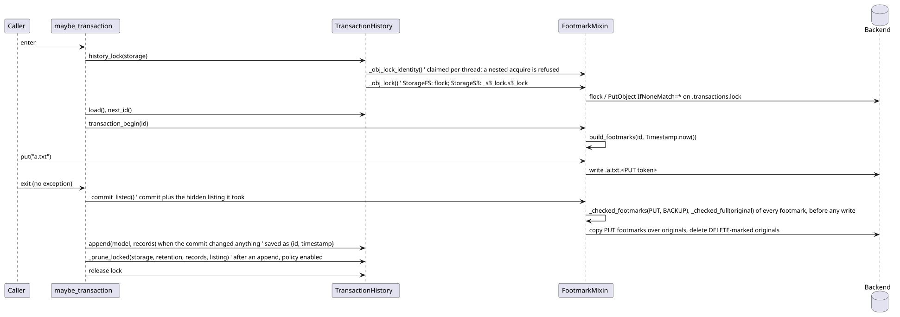
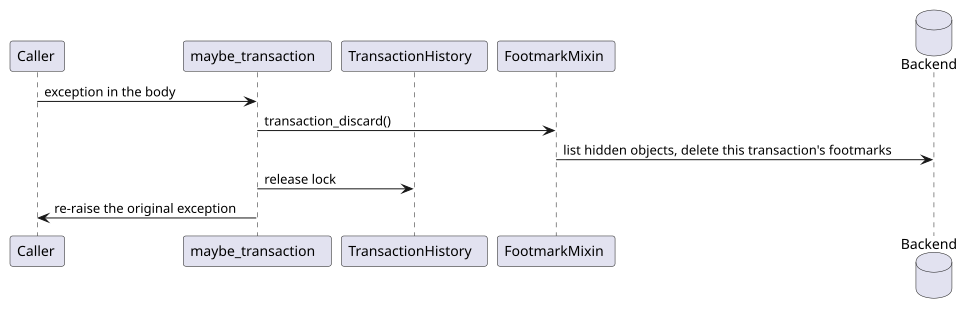
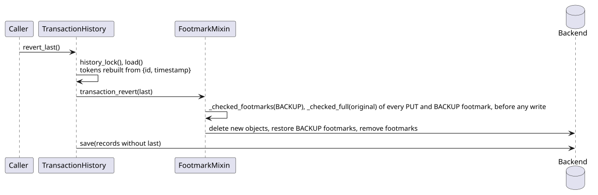

# Transaction flows

How a transactional write is staged, committed, recorded, and reverted, and where the history lock
and auto-prune sit. Behavior is owned by [STORAGE.md](../../STORAGE.md#transactions) and
[STORAGE.md](../../STORAGE.md#transaction-history); the user view is
[transactions.md](../guides/transactions.md).

## Code map

| Concern | Module | Notes |
| -- | -- | -- |
| Algorithm | `txstore/transaction.py` | `FootmarkMixin` begin, commit, discard, revert |
| Reclaim | `txstore/_reclaim.py` | `ReclaimMixin` find and forget, transaction and orphan footmarks |
| Context manager | `txstore/history.py` | `maybe_transaction` |
| History and lock | `txstore/history.py` | `TransactionHistory`, `history_lock` |
| Tokens | `txstore/footmark.py` | `build_footmarks`, `parse_footmark_token` |

## Commit with history

### Details that matter

- The history is loaded before `transaction_begin`, so a malformed file aborts the write with
  nothing staged → [STORAGE.md](../../STORAGE.md#failure-semantics).
- An exception in the body discards the staged footmarks and re-raises unchanged; a failing discard
  is logged, never masks it.
- A metadata verb on a DELETE-marked object raises and stages nothing; `_stage_for_metadata_change`
  checks the marker first → [STORAGE.md](../../STORAGE.md#footmarks).
- Commit leaves the footmarks in place: they are what revert uses to restore originals. Retention
  reclaims them later.
- Commit and revert map each listed footmark to its original by the listed name, never the resolved
  path, and check every original through `_checked_full` (`_obj_check_reserved`) before the first
  write, so a planted footmark naming a reserved object, the root, or a path outside it raises
  `StorageException` with nothing applied → [STORAGE.md](../../STORAGE.md#lifecycle),
  [VALIDATION.md](../../VALIDATION.md#filename-safety).
- Commit also passes each listed PUT and BACKUP footmark through `_obj_checked_footmark` before the
  first write: on FS a symlink or non-regular footmark is refused, and one gone since the listing
  raises `StorageException`, not `StorageNotFoundException`, since the caller's own object is not
  what is missing → [VALIDATION.md](../../VALIDATION.md#filename-safety). Revert checks only its
  BACKUP footmarks this way (see [Revert](#revert)).
- An empty commit (no PUT, DELETE, or BACKUP footmark) appends no record and skips the prune →
  [STORAGE.md](../../STORAGE.md#recording-rules).
- Auto-prune reuses the hidden-object listing the commit already made, and any prune failure is
  logged and swallowed because the commit is already durable.
- A failing commit raises and records no history. After a failing copy or delete, a direct
  `transaction_commit()` keeps the transaction active for a retry. Every attempt checks the listing
  against `_staged_footmarks`, the instance's ledger of what it staged, so a footmark gone from
  storage refuses the commit instead of being skipped; a refused original applies nothing →
  [STORAGE.md](../../STORAGE.md#lifecycle). `maybe_transaction` abandons a failed commit instead,
  keeping the footmarks (BACKUPs included) for an orphan sweep, so the instance can begin again →
  [STORAGE.md](../../STORAGE.md#failure-semantics).

## Discard

### Details that matter

- Discard makes one `_obj_reclaim_delete_many` call (S3: `DeleteObjects` batches), then retries each
  failed path through `_reclaim_footmark`: every retry runs, the first failure is raised, and later
  ones are logged as warnings → [STORAGE.md](../../STORAGE.md#lifecycle). It deletes the path
  `_obj_checked_footmark` returns, and on FS that primitive refuses a listed footmark that escapes
  the root or is not a regular file, so a planted symlink fails the discard instead of reaching its
  target → [VALIDATION.md](../../VALIDATION.md#filename-safety).
- A failing discard is logged and the body's exception propagates unchanged; nothing is recorded,
  and the transaction is abandoned with its footmarks kept for an orphan sweep.

## Revert

### Details that matter

- Tokens are never stored: `Timestamp.from_json` and the wire codec rebuild them bit-identically
  from the record, which is why both are frozen → [footmark.md](footmark.md).
- A record whose footmarks are already gone reverts as a no-op with a warning.
- Revert checks every original before its first write, as commit does, so a planted footmark fails
  it the same way with nothing changed.
- Revert only copies from its BACKUP footmarks, so only those pass `_obj_checked_footmark` up front;
  a PUT footmark is never read, only deleted in the logged best-effort cleanup, where the same check
  refuses a symlink or non-regular one → [STORAGE.md](../../STORAGE.md#lifecycle).

## Testing notes

`tests/test_transactions.py` runs the lifecycle on the in-memory, FS, and S3 backends, with failure
injection; `tests/test_fs_transactions.py` and `tests/test_s3_transactions.py` keep what is
backend-specific; `tests/test_history.py` covers records, locking, retention, and the orphan sweep;
`tests/test_transaction.py` covers `maybe_transaction` with stubs.

## Related contracts

- [STORAGE.md](../../STORAGE.md#lifecycle), [STORAGE.md](../../STORAGE.md#retention), and
  [STORAGE.md](../../STORAGE.md#locking) own every step above.
- [ROADMAP.md](../../ROADMAP.md#known-deviations) records where atomicity is best-effort.
- Sibling pages: [architecture.md](architecture.md), [class.md](class.md), [s3.md](s3.md),
  [footmark.md](footmark.md).
